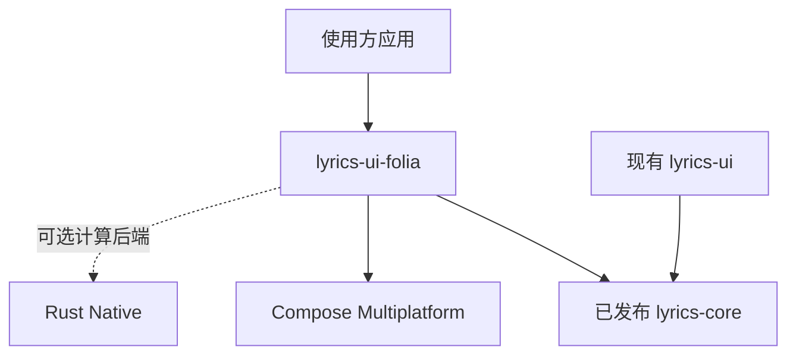

# lyrics-ui-folia 实施计划

2026-11-16用户新增授权：可实验Rust调查性能问题。首项development-only CPU遮罩
JNI原型与同算法Kotlin公平对照，真实支持/收益及未验证项见docs/performance.md。
不因此放宽主题效果验收或让默认库依赖Rust；native未正式接入示例。

2026-11-16优先级变更：按用户新增要求推进多主题文字行为，首项云阶Partita，
再倾诉、浮名、心象、群唱、时计及镜台文字/镜头范围调查。真实支持与验收差异见
docs/themes-parity.md；下文“首版仅classic”及旧扩展顺序不再代表当前实施顺序。
未实现主题不加入公共选择器冒充支持，classic既有残差和验收标准继续保留。

2026-11-15变更：默认流程改为用户选音频并实际播放，歌词/翻译可选；合成场景转到
开发/演示入口。单向复用原lyrics-ui有限时间呼吸球。本项覆盖下文默认合成及音频延期
的旧安排，具体实施/验收见docs/local-playback.md；完成后回classic核心视觉对照。

日期：2026-11-14。状态：已开始实现；实际进度和验证见 docs/implementation.md，以下未完成阶段仍为计划。

详细设计：[组件、数据、时序与渲染](docs/DESIGN.md)；[Rust Native 后端](docs/NATIVE_DESIGN.md)；[参考现有 UI 的独立示例项目](docs/SAMPLE_DESIGN.md)。以下 API 为早期草案，公共契约与实现细节以详细设计为准。

## 1. 目标与已确定的边界

创建独立的 Kotlin / Compose Multiplatform 歌词显示库 `lyrics-ui-folia`，移植 Folia 的歌词文字排版、逐词／逐字显示与文字转场。它与现有 `lyrics-ui` 并列，供应用选择使用。

移植与视觉验收直接以原始仓库 `chthollyphile/folia-major` 为准。`spw-folia` 只作为播放器向歌词组件传递数据、播放状态与交互回调的接入思路参考；无需实现 SPW，也不将其插件架构移植到本库。

| 项目 | 位置／发布名 | 责任 |
| --- | --- | --- |
| 原有项目 | `F:\android app code\Accompanist`，`lyrics-ui` | 继续独立维护现有 Apache-2.0 歌词界面 |
| 新项目 | `F:\android app code\lyrics-ui-folia`，`lyrics-ui-folia` | 独立实现 Folia 文字显示，按约定的 AGPL 路线维护 |
| 共用数据依赖 | 已发布的 `lyrics-core` | 提供 `SyncedLyrics`、歌词行和音节模型 |

新项目已建立独立 Git 仓库、Gradle settings、依赖配置、版本号、示例和本地验证产物；CI 尚未配置。实际完成项和未验证项见 docs/implementation.md、docs/delivery.md；以下仍包含未完成的设计目标。

必须遵守：

- 不修改原工程的源码、构建文件、许可证、依赖、示例或发布流程。
- 不在原工程增加 `include`、`includeBuild`、子模块、符号链接或 Folia 测试素材。
- 新库不依赖 `lyrics-ui`，不继承其 `KaraokeLyricsView`，不引用其 `internal` 实现。
- 不为新库向原工程增加渲染扩展接口；新库自行提供 `FoliaLyricsView`。
- Folia 来源代码、素材、参考截图和相关声明全部留在新项目。
- 若复用 Apache 来源代码，只能在新项目中按来源要求保留归属与声明，不能把 Folia 代码反向带回原工程。

## 2. 范围

### 首个版本

- Android 与 JVM Desktop 两个平台的独立歌词组件。
- 首个正式样式：流光 `classic`。
- 当前句排版、词级入场、缩放、位移、旋转、颜色变化、辉光、余韵及整句退场。
- 翻译字幕、下一句提示、前奏／句间空档显示。
- 兼容逐音节歌词和仅有行时间的歌词；后者明确采用行级显示或派生时序，不把派生值宣称为真实逐字时间。
- 暂停、恢复、倍速、前后跳转、切歌、循环和窗口大小变化。
- 参考现有 `lyrics-ui` 示例 UI，独立编写 Android／Desktop 示例：自适应播放器页面、内置歌词、无音频演示时钟、播放／暂停／跳转／倍速／循环、本地歌词导入与设置面板；详见示例设计。
- 视觉对照和性能测试；默认示例无需原工程、SPW、真实音频或 Rust 环境即可运行。

### 后续扩展

按 `tilt` → `partita` → `claddagh` 顺序扩展；这是初始优先级，每个样式进入开发前先确定文字部分的可复刻范围。其他样式按文字算法复杂度和实测性能分别评估。

### 当前不纳入

- SPW 接入或兼容实现，包括插件 API、Hook、C# 宿主、IPC、消息协议、打包流程与 SPW 运行验证。
- WebView2、Electron、React 设置界面。
- 背景、封面配色系统、桌面透明窗口、音频采集、频谱、节拍模型和播放队列管理。
- 整套三维场景、镜头与粒子系统；与文字不可分离的特效需单独立项。
- 修改歌词解析器、复制完整上游播放器、一次性移植全部 17 种样式。
- 首版 iOS 支持；先保持公共逻辑可移植，再安排 macOS / iOS 构建与实机验证。

`classic` 中依赖额外曲目语义或音频输入的增强效果，先保留清晰的可选输入或记录为差异，不为此引入整套分析系统。

## 3. 来源基线与授权记录

使用固定基线做首轮对照，不跟随上游主分支自动更新：

| 来源 | 固定基线 | 用途 |
| --- | --- | --- |
| Folia 原始仓库 `chthollyphile/folia-major` | `v0.7.26`，`cc6226e464050a456a2913e062374f23d3844cc5` | 歌词显示源码的移植来源；样式、排版、时序、动画和视觉验收均以此为准 |
| `azkbzxf/spw-folia` | `6181abb4a2adcea8de7e5823c29392e73297caff` | 仅参考播放时间、歌词数据、状态与回调如何接入；不作为移植来源或实现依赖 |
| 当前本地 `lyrics-ui` 工程 | 仅作只读接口与示例 UI 参照 | 确认数据、毫秒时钟、回调，以及窄／宽屏布局和交互；在新项目独立实现 |

优先阅读的 Folia 文件：

- `src/types.ts`。
- `src/components/visualizer/classic/Visualizer.tsx`。
- `src/components/visualizer/GlowWord.tsx`。
- `src/components/visualizer/glowWordTiming.ts`、`glowWordVariants.ts`、`wordGlow.ts`。
- `src/components/visualizer/glowWordOverlap.ts`。
- `src/utils/lyrics/graphemeTiming.ts`、`cjkSemanticLayout.ts`、`renderHints.ts`。
- `src/components/visualizer/runtime.ts` 与字幕布局相关文件。

新项目目标许可为 `AGPL-3.0-only`，在首次搬入代码前直接核对 Folia 原始仓库的适用授权声明。Folia 固定版本的 `package.json` 和 README 写 `AGPL-3.0`；P0 必须记录适用声明并确认具体版本选择，不使用 SPW 插件的许可声明代替原始代码的授权，也不以许可证全文末尾的使用示例代替项目授权声明。

工程初始化时准备 `LICENSE`、`NOTICE`、`THIRD_PARTY_NOTICES.md` 和 `docs/upstream.md`，记录来源路径、提交、版权、修改方式及第三方依赖。发布前核对源码包、二进制元数据与声明一致。原有项目的 Apache-2.0 文件及发布配置保持原状。

## 4. 工程与依赖设计

当前本地验证坐标：`top.ghhccghk.accompanist:lyrics-ui-folia:0.1.0-SNAPSHOT`；Kotlin 包名：`top.ghhccghk.accompanist.lyrics.folia`。以下为目标结构，其中 native 尚未创建：

```text
lyrics-ui-folia/
  PLAN.md
  README.md
  LICENSE
  NOTICE
  THIRD_PARTY_NOTICES.md
  settings.gradle.kts
  build.gradle.kts
  gradle/libs.versions.toml
  library/
    src/commonMain/           # 对外 API、数据适配、排版、动画与绘制
    src/commonTest/           # 时序、布局、动画契约测试
    src/androidMain/          # Android 平台实现
    src/jvmMain/              # Desktop 平台实现
  sample/
    shared/                  # 参考原示例 UI 独立实现的页面、场景、控制器
    android-app/
    desktop-app/
  native/                    # Rust 路线启用后再创建
    Cargo.toml
    crates/folia-compute/     # 纯计算实现
    crates/folia-ffi/         # ABI 与生命周期封装
  docs/
    upstream.md
    visual-spec.md
    DESIGN.md
    NATIVE_DESIGN.md
    SAMPLE_DESIGN.md
    performance.md
```

依赖关系：



- `lyrics-core` 先以原工程当前配置的 `0.5.0` 为候选，P0 验证实际模型与依赖可获取性，不将其称为最新版本。
- 工具链版本在 P0 锁定兼容组合，避免与现有工程隐式共享构建配置。
- 若核心依赖需要自定义 Maven 仓库，通过新项目的配置参数接入，不写死本机盘符。
- Android 的 `minSdk` 以 21 为兼容目标；P0 确认 Compose 工具链要求，并列出模糊等效果的后端限制与降级行为。
- Rust 支持先保留模块边界；是否实际引入原生二进制，由性能阶段决定。

## 5. 对外组件约定

提供 `FoliaLyricsView`，不要求调用方创建 `LyricsLazyListState`。详细设计将主入口细化为一次读取位置、暂停状态和跳转版本的播放快照：

```kotlin
@Composable
fun FoliaLyricsView(
    lyrics: SyncedLyrics,
    playback: () -> FoliaPlaybackSnapshot,
    modifier: Modifier = Modifier,
    contentKey: Any = lyrics.id,
    style: FoliaStyle = FoliaStyle.Classic(),
    onLineClicked: (ISyncedLine) -> Unit = {},
    onLinePressed: (ISyncedLine) -> Unit = {},
    options: FoliaOptions = FoliaOptions(),
)
```

该签名为精简示意，完整配置参数见详细设计。P1 确认公共类型和默认值；不提前承诺 ABI 稳定性，也不暴露未实现样式。`FoliaPlaybackSnapshot` 包含毫秒位置、`isPlaying` 和 `discontinuity`，另提供兼容 `currentPosition: () -> Int` 的便捷重载。

- 公共输入时间统一使用毫秒，播放快照读取可观察的 Compose 状态；内部使用有符号微秒时间计算。
- 调用方负责提供已经按播放速度更新的媒体位置；`isPlaying` 用于暂停文字动效，不再次乘倍速。
- 点击回调返回原始行，避免丢失调用方数据身份。
- 选项覆盖字体、主／辅文字颜色、翻译与下一句开关、动效强度及减少动态效果。
- 曲目切换或显式跳转如需额外标识，增加可选标识／时钟适配器；不能强制使用某个播放器 SDK。
- 字体加载、文字方向和尺寸变化必须使相关准备缓存正确失效。
- 接入直接通过 Kotlin 数据、Compose 状态和函数回调完成；SPW 的桥接／消息形式只用于理解输入语义，不转化为本库的协议或平台依赖。

## 6. 内部实现

### 数据适配

从 `lyrics-core` 映射到新库内部只读模型。分别保留原始行、计时音节、显示词组、字素及其时间映射。

- 不修改输入歌词与原始时间。
- Folia 的词组边界不能直接等同于 `KaraokeSyllable`；显示分组与时间分组分开处理。
- 行时间、音节时间、译文、注音／罗马音、伴唱和多声部逐项建立支持矩阵。
- 缺少 Folia 的 `renderHints`、语义分词、合唱标记等信息时，使用明确定义的派生规则或默认行为。
- 首版保留全部声部数据；重叠主唱、伴唱的实际展示策略在 P1 固定并测试，不能隐式覆盖成单一活动行。

### 文字准备与布局

使用 Compose 的文本测量与塑形生成可复用的布局和字形边界；按样式派生位置、旋转支点、放大后的视觉边界和安全间距。

- 文字、字体、约束、样式发生变化时准备，播放逐帧更新不重新测量。
- 保护字素、连字和上下文 shaping；不为动画直接逐 UTF-16 字符独立排版。
- 布局中的随机分布由固定种子生成；种子算法明确记录，重复准备保持一致。
- 字号、视觉溢出、长句换行、横竖屏和 RTL 都纳入布局约束。

### 时间与动画

将 `waiting / active / passed` 状态、提前入场、词内高亮、整句切换、余辉和退场统一到可计算的时间模型。

- 从当前媒体位置计算可恢复的显示状态，跳转后不依赖补放之前所有动画事件。
- 对上游依赖组件挂载时间或墙钟的 spring／transition，在视觉规格中明确移植规则，避免声称逐帧完全一致。
- 暂停默认冻结歌词文字动效；恢复、倍速和循环保持一致的时间语义。
- 重绘区间覆盖入场前视与唱后余韵；词结束不等于动画结束。
- 手势反馈如需独立时钟，应与媒体时钟分离。

### 绘制与交互

首版使用 Kotlin / Compose Canvas 与图层完成文字绘制，并把动画参数计算与绘图后端分开。

- 文字正文、辉光和字幕分层，避免正文被辉光过度模糊。
- 缓存布局、绘制资源与可复用缓冲区，限制逐帧对象分配。
- 保留切句期间旧句的退场资源，完成后及时释放。
- 点击命中与当前文字变换对应，避免只按变换前矩形判断。
- 对不可用或开销过大的模糊效果定义平台降级；记录观感差异。

## 7. Rust Native 可选性能路线

Rust 是可选计算后端，不预设改写后一定更快。P2 先建立 Kotlin 实现的 CPU、GPU、内存和帧耗时基线，P3 依据分析定位瓶颈。保留 Kotlin 路径作为行为参照与后端回退。

### 候选下沉范围

| 热点 | Rust 候选方案 | 进入条件 |
| --- | --- | --- |
| 大量词／字素动画采样 | 按批计算透明度、位移、缩放、旋转和颜色参数 | 采样被证明占用显著 CPU 时间 |
| 复杂布局规划 | 在已测量的字形尺寸上批量计算分组、碰撞和空间布局 | 优化算法与缓存后仍存在明显瓶颈 |
| 几何或遮罩数据生成 | 在 Rust 中生成可复用的数值缓冲区 | 数据规模足以摊薄跨语言开销 |
| 软件图像／滤波处理 | 单独评估计算内核或图形后端 | 已确认瓶颈在该处理，且不是 GPU／合成等待 |

普通播放行查找、简单进度计算、Compose 状态、点击事件和字体调用先保留 Kotlin。文字塑形与字体回退首版由 Compose 负责，不同时维护一套 Rust 字体系统。

GPU 填充、模糊合成或纹理上传成为瓶颈时，先评估降低图层开销、缓存或调整渲染策略；如果需要独立 native GPU 绘制，另写设计说明并验证与 Compose 的表面、同步及生命周期衔接，不能把“改用 Rust 计算”当成已经解决 GPU 问题。

### 调用边界

- 数值内核只接收时间、布局参数、标识和连续数组；不传 Compose 对象或逐帧传完整歌词字符串。
- Android／Desktop JVM 候选通过 JNI 接入；未来 Kotlin/Native 平台通过 C ABI + cinterop 接入。
- 优先按整批可见单元调用，准备阶段传静态数据，采样阶段复用输入输出缓冲区；不对每个字做一次 native 调用。
- 不在热路径采用 JSON 序列化或 native 反调 Kotlin 来测量文字。
- 明确 buffer 的分配方、释放方、有效期、容量、线程归属和资源关闭时机。
- FFI 只暴露稳定 C ABI 形状、状态码和受控句柄，不直接暴露 Rust 容器布局；panic 不跨 ABI 边界传播。
- 后端选择、加载失败和 ABI 不支持时的行为通过内部适配层统一处理，对外歌词组件 API 不感知 native 指针。

### 构建与发布

- 在新项目独立锁定 Rust、NDK 和目标架构，Gradle 与 Cargo 的输入／产物关系可重复构建。
- Android 优先验证 `arm64-v8a` 实机与 `x86_64` 模拟器；其他 ABI 按实际支持需求增加。
- Desktop 优先验证当前开发环境的 Windows x64，其他系统／架构按有运行验证的矩阵发布。
- 记录动态库打包、加载、符号、ABI 版本和 native 调试信息；Android 产物验证当前 native 打包与页面大小要求。
- 库本体、可选 native 产物及 Kotlin 回退的依赖关系在 P3 小实验后确定，优先保持未启用 native 的构建可用。
- Cargo 第三方依赖与来源声明纳入新项目发布清单。

### 启用门槛

先选一个真实热点做小实验，对比同一设备、歌词、分辨率和样式下的 Kotlin／Rust 版本。测量计算、JNI／FFI、复制、分配和最终帧耗时的完整成本，不只比较 Rust 内部函数。

进入正式实现需满足：行为一致；目标热点端到端成本有稳定改善；P95／P99 帧耗时或准备延迟随之改善；内存、安装包和构建成本可接受。可暂以热点总成本降低约 20% 作为评审参考，具体数值在基线完成后确定，不能作为既有性能结论。

若收益不足，保留实验记录与 Kotlin 实现，不为了采用 native 而扩大复杂度。

## 8. 分阶段任务与完成条件

| 阶段 | 任务 | 完成条件 |
| --- | --- | --- |
| P0：独立工程与来源 | 建立新仓库、KMP 工程、许可／来源记录；锁定依赖与工具链；创建 shared／Android／Desktop 示例壳 | Android / Desktop 最小工程与示例骨架可构建；原项目没有因本任务新增改动；上游授权版本已核对 |
| P1：数据与静态显示 | 完成模型适配、字体测量、当前句和字幕、静态 `classic` 布局 | 固定尺寸与字体下长句、RTL、空档、声部和输入身份测试通过 |
| P2：classic 动画 | 完成词状态、spring／曲线、辉光、句切换、跳转与暂停；接通示例时钟、播放控制、设置和本地歌词导入 | Android／Desktop 示例可交互运行；时间与视觉对照通过；产出 Kotlin 性能基线 |
| P3：性能与 Rust 决策 | 定位热点、优化 Kotlin；如有必要完成一项 Rust 端到端实验 | 记录是否启用 Rust 及依据；若启用，补齐生命周期、行为一致性和打包验证 |
| P4：首版交付 | 按示例设计验收自适应 UI、状态、快捷键与生命周期；完成运行说明、支持矩阵、来源清单、独立发布配置 | 两端示例可脱离原工程运行；本地 Maven 产物可由独立使用方加载；声明和源码包完整；公开发布另行执行 |
| P5：扩展样式 | 依次评估 `tilt`、`partita`、`claddagh` | 每个样式单独达到行为、视觉和性能标准，不阻塞首版 |

不预设总工期。P1 完成后依据真实排版差异估算 P2；P2 基线完成后评估 Rust 路线与高级样式成本。

## 9. 验证方案

### 行为与数据

- 前奏、句间空档、歌曲末尾、空歌词和无翻译。
- 极短音节、零时长单元、长音、密集切句与时间戳边界。
- 中文、英文、混排、emoji／组合字符及至少一种 RTL 或复杂 shaping 文字。
- 多行换行、译文／注音开关、重叠主唱与伴唱。
- 顺序播放、暂停恢复、前后跳转、倍速、循环和换歌；直接跳到时间点与顺序播放到该点的状态一致。
- 组件移除／重建、字体加载完成、字号与窗口尺寸变化。

### 视觉

使用可分发的合成歌词样本，在相同字体、视口、随机种子和媒体时间下，直接对照固定版本 Folia 原始仓库的文字显示。参考渲染运行在 Folia 自身的开发／浏览器入口中，不要求安装 SPW 或运行 SPW 插件。覆盖入场前、开始、词中、词后、句尾、退场与下一句进入等时间点，并补充连续录屏。

像素比较用于定位差异；不同字体渲染后端不要求逐像素相同。重点验收时间边界、词组、布局、变化趋势、视觉溢出、可读性和交互。`docs/visual-spec.md` 记录有意调整与后端差异，不能只以“看起来接近”完成验收。

### 性能

- 固定并记录设备、系统、渲染后端、分辨率、刷新率、字体和样本。
- 区分首次布局、暖缓存、稳定播放、切句、连续跳转和尺寸变化。
- 记录准备耗时、帧耗时 P50／P95／P99、分配、GC、CPU／GPU 与资源峰值。
- Android 中端实机以稳定 60Hz 为首轮目标；高刷新率作为补充，不在未测量前承诺全平台 120Hz。
- 原生路线启用后增加 native 内存、调用次数、缓冲复制及加载／释放验证。
- 暂停、不可见和组件销毁后不应保留无必要的持续计算或悬挂资源。

### 项目边界

- 新工程没有对 `lyrics-ui` 的源码工程引用、内部包依赖或本地路径绑定。
- 原工程构建、依赖、许可证及发布元数据未被本任务改动。
- 本地发布产物在新建的独立使用方工程中可用，不需要把原仓库放在旁边。

## 10. 首个可用版本的定义

使用方添加 `lyrics-ui-folia` 依赖，传入现有 `lyrics-core` 数据与可观察的毫秒播放位置，即可在 Android 和 Desktop 示例中显示 `classic` 文字效果；暂停、跳转和切歌正确，来源与许可记录齐全，性能有可复现的测量结果。

首版交付以 Kotlin 路线为可用基线。若 Rust 实验证明值得启用，则同一公共 API 支持 native 加速及已定义的回退；否则按 Kotlin 实现交付，不把 native 当作首版的强制前置条件。

## 11. 参考资料

- Folia 固定基线：<https://github.com/chthollyphile/folia-major/tree/cc6226e464050a456a2913e062374f23d3844cc5>。
- SPW 接入思路参考（不在实现范围内）：<https://github.com/azkbzxf/spw-folia/tree/6181abb4a2adcea8de7e5823c29392e73297caff/docs>。
- Android 官方 JNI 指南：<https://developer.android.com/ndk/guides/jni-tips>，用于批量边界、线程与资源传递设计。
- Rust 官方 FFI 指南：<https://doc.rust-lang.org/nomicon/ffi.html>，用于 C ABI、所有权与边界封装。
- Kotlin 官方 C interop 指南：<https://kotlinlang.org/docs/native-c-interop.html>，用于未来 Kotlin/Native 平台接入；它不替代 Android / JVM 的 JNI 路径。
