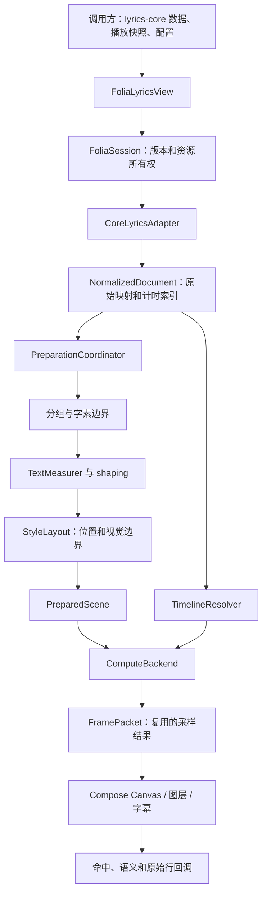
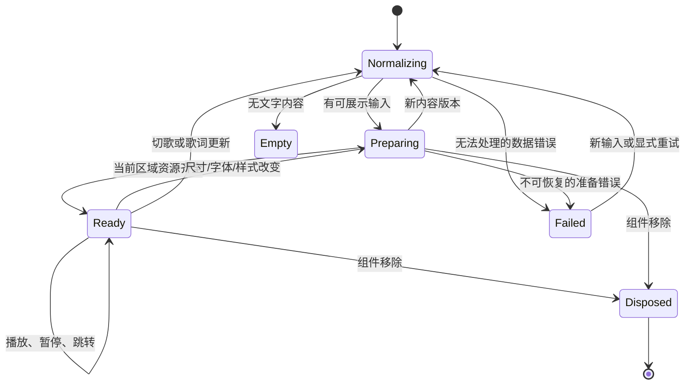

# lyrics-ui-folia 详细设计

日期：2026-11-14。版本：设计草案 0.1。状态：部分实现；本文保留目标契约，实际 API、测量和剩余验收分别见源码、implementation.md、delivery.md，不把设计目标当作已经支持。

本文细化 [PLAN.md](../PLAN.md)。Rust ABI、native 发布与资源生命周期见 [NATIVE_DESIGN.md](NATIVE_DESIGN.md)；参考现有 UI 的独立 Android／Desktop 示例见 [SAMPLE_DESIGN.md](SAMPLE_DESIGN.md)。公共 API 与内部职责以本文为准；改变既定范围时同步修改计划。

2026-11-15 用户批准的兼容扩展：`FoliaColors.subtitleBackground` 默认为透明，
宿主可提供主题背景色以启用原版字幕阴影与局部光垫；
`FoliaOptions.showSubtitleBackground` 默认为 true，透明色时不增加 padding 或绘制。
设为 false 可仅保留主题文字阴影。显式 `typography.subtitle.shadow` 优先于派生阴影。
局部光垫仅服务字幕可读性，不实现背景引擎。旧调用的透明布局和效果保持不变。

## 1. 交付目标与工程边界

`lyrics-ui-folia` 是与 `lyrics-ui` 并列的独立歌词显示库，通过 Kotlin / Compose Multiplatform 实现 Folia 的文字排版与动画。首版交付 Android、JVM Desktop 和 `classic` 样式。

| 决策 | 约定 |
| --- | --- |
| 工程位置 | `F:\android app code\lyrics-ui-folia` |
| 发布坐标 | `com.mocharealm.accompanist:lyrics-ui-folia` |
| 包名 | `com.mocharealm.accompanist.lyrics.folia` |
| 组件入口 | `FoliaLyricsView` |
| 数据来源 | 已发布 `lyrics-core`；当前已核对本地 `0.5.0` sources JAR 的模型 |
| 上游实现 | 原始仓库 `chthollyphile/folia-major`，固定 `v0.7.26` / `cc6226e464050a456a2913e062374f23d3844cc5` |
| SPW 的角色 | 仅用于理解播放器数据／状态／回调接入；不实现其插件、宿主、协议或打包 |
| 原工程 | 不增加依赖、扩展接口、示例、测试素材、构建引用或许可证修改 |
| native | 可选 Rust 计算后端，由端到端性能验证决定启用范围 |

新项目独立建仓、构建、测试与发布，不在原仓库下创建模块。运行参考用的上游网页和截图工具只属于开发验证工具，不进入库的运行时依赖。

新项目采用用户确认的 `AGPL-3.0-only`；固定版本适用声明已直接核对，证据见 upstream.md。来源清单逐文件记录提交、归属和改动，不以 SPW 的授权声明替代 Folia 原始代码授权。

## 2. 架构决策

| 编号 | 决策 | 原因与约束 |
| --- | --- | --- |
| D01 | 独立组件，不依赖 `lyrics-ui` | Folia 的单句场景与现有滚动列表布局不同，避免形成反向依赖 |
| D02 | 媒体位置由使用方提供 | 不依赖播放器 SDK，不重复进行倍速插值 |
| D03 | 时间采样可重建 | 跳转、循环、截图与 Kotlin / Rust 对照不依赖事件补播 |
| D04 | 计时、分词、shaping 和绘制身份分离 | 合并显示词不能丢失原始音节时间；字素不一定能独立塑形 |
| D05 | 文本测量和图形资源留在 Compose 侧 | 首版复用平台字体能力，Rust 只处理纯数值 |
| D06 | 当前区域与有限前视按需准备 | 首屏不等待整首歌词逐字测量；资源量有界 |
| D07 | Kotlin 是行为基准 | 先建立可用组件与基线，再判断 native 收益 |
| D08 | 特殊布局是样式内部实现 | 不以 `classic` 的横向行框限制后续环形／分栏 |

## 3. 模块与职责



建议包结构：

```text
folia/
  api/                    # 对外组件、配置、快照、状态、样式
  internal/model/         # 标准化数据、来源映射、诊断
  internal/adaptation/    # lyrics-core 到内部模型
  internal/text/          # 分词、字素、塑形边界与字体失效
  internal/preparation/   # 按需准备、缓存、版本和取消
  internal/layout/       # 样式共享的几何工具
  internal/timeline/     # 活动集合、主句、空档、转场窗口
  internal/animation/    # 时序提示、spring、缓动和辉光
  internal/rendering/    # 文本资源、Canvas、图层和命中
  internal/styles/classic/
  internal/compute/      # Kotlin 数值后端
  spi/                   # 可选 native 适配器需要的受限接口
```

`internal` 类型不作为使用方扩展系统。首版不开放任意第三方样式插件注册；内部样式接口先满足内置样式与后续移植。

## 4. 公共 API

### 4.1 主入口

以下为拟实现签名，默认配置工厂和具体 import 在 P0 / P1 固定：

```kotlin
@Immutable
data class FoliaPlaybackSnapshot(
    val positionMillis: Long,
    val isPlaying: Boolean,
    val discontinuity: Long = 0L,
)

@Composable
fun FoliaLyricsView(
    lyrics: SyncedLyrics,
    playback: () -> FoliaPlaybackSnapshot,
    modifier: Modifier = Modifier,
    contentKey: Any = lyrics.id,
    style: FoliaStyle = FoliaStyle.Classic(),
    typography: FoliaTypography = FoliaDefaults.typography(),
    colors: FoliaColors = FoliaDefaults.colors(),
    options: FoliaOptions = FoliaOptions(),
    annotations: FoliaAnnotations = FoliaAnnotations.Empty,
    onLineClicked: (ISyncedLine) -> Unit = {},
    onLinePressed: (ISyncedLine) -> Unit = {},
)
```

采用一个播放快照，保证位置、暂停状态和跳转版本来自同一次读取。快照 provider 必须快速、无副作用，读取可观察的 Compose 状态；不能在其中做 I/O、跨线程等待或每帧调用耗时播放器接口。

- `positionMillis` 是实际媒体位置，已包含播放器倍速影响。库不再乘速度。
- `discontinuity` 在显式 seek、循环或控制器重置时递增；普通进度采样保持不变。
- `contentKey` 区分曲目／文档会话；`SyncedLyrics.id` 可能为默认值 `"0"`，因此它不是唯一缓存键。
- 新歌词对象或注释更新同样触发内容版本更新。同一份输入不允许原地修改可变列表；调用方应发布新对象。
- 组件不播放音频，也不通过点击自行 seek；回调交给使用方。
- `Int` 播放位置适配函数在边界转成 `Long`；内部不做 `Int` 时间加减。

### 4.2 兼容现有调用习惯

提供便捷重载，输入 `currentPosition: () -> Int`、`isPlaying: Boolean` 和可选 `discontinuity: Long`，转换成主入口快照；两种入口只保留一套实现。该重载不能提供与播放器 SDK 无关的自动 seek 识别保证，调用方应传入真实跳转标记。

### 4.3 样式与配置

```kotlin
sealed interface FoliaStyle {
    @Immutable
    data class Classic(
        val tuning: ClassicTuning = ClassicTuning(),
    ) : FoliaStyle
}

@Immutable
data class ClassicTuning(
    val enableWordRotation: Boolean = true,
    val breathingFloatMultiplier: Float = 1f,
    val wordSpacing: Float = 0.7f,
    val avoidOverlap: Boolean = false,
)
```

以上四项默认值与固定上游 `DEFAULT_CLASSIC_TUNING` 对应。`breathingFloatMultiplier`、`wordSpacing` 输入限制为有限数并归一到 `0..2`。首版实现上游非 legacy 布局；旧版布局开关不作为公共承诺。

| 配置类型 | 首版字段／行为 |
| --- | --- |
| `FoliaTypography` | 主句、次声部、翻译／罗马音和下一句文字样式；响应式字号策略；字体回退 |
| `FoliaColors` | 正文色、活动色、次要色；不依赖封面主题推导 |
| `FoliaOptions` | 字幕行组合、文字可见性、减少动态效果、动效强度、歌词偏移、质量档位、计算后端偏好 |
| `FoliaAnnotations` | 按来源行定位的可选分词边界和附加语义；不改写 `lyrics-core` |
| `FoliaStatus` | 内容准备／可绘制／带降级可绘制／数据错误，供可选状态观察使用 |

已实现的动效强度入口为 `FoliaOptions.animationIntensity`，取值
`FoliaAnimationIntensity.Calm / Normal / Chaotic`，默认 Normal。对应原版主题强度；
不需要额外主题引擎，也不改变现有默认调用。各档实际验收范围见 classic-parity.md。

配置必须区分影响范围：字号、字体、分词和布局参数改变需要准备；颜色改变更新绘制资源；播放位置改变只更新时间／帧参数；减少动态效果改变采样策略，不重新解析整首歌词。

不暴露 native 指针、纹理句柄、内部单元数组或 Rust ABI。调试开关和性能采样放在明确标记的诊断 API 中。

## 5. 数据契约与标准化

### 5.1 已核对的 core 模型

以下来自本地 Gradle 缓存 `lyrics-core-0.5.0-sources.jar`，不是根据名称猜测：

| core 类型 | 已确认字段 | 映射 |
| --- | --- | --- |
| `SyncedLyrics` | `lines: List<ISyncedLine>`、`id`、标题等 | 文档输入；保留每个来源行的位置与对象引用 |
| `ISyncedLine` | `start: Int`、`end: Int`、`duration` | 仅提供时间；自定义实现可能没有可读文字 |
| `KaraokeLine.MainKaraokeLine` | `syllables`、翻译、alignment、phonetic、languageTag、可空伴唱列表 | 主唱和嵌套伴唱 |
| `KaraokeLine.AccompanimentKaraokeLine` | 音节、翻译、alignment、phonetic、languageTag | 次声部；保留原始行 |
| `KaraokeSyllable` | content、起止时间、phonetic、languageTag、phoneticSeparatorBefore | 原始计时单元与字幕分隔信息 |
| `SyncedLine` | content、翻译、起止时间、phonetic、languageTag | 行级文字，默认不伪造真实逐字时间 |
| `UncheckedSyncedLine` | 与行级文字相近，但可能出现逆序时间 | 经明确的数据校验策略处理 |

自定义 `ISyncedLine` 没有文字字段时不能 `toString()` 当歌词。首版产生 `UnsupportedLineType` 诊断并跳过该行的文字绘制；仍保留来源信息。支持额外类型以后通过适配接口增加。

### 5.2 内部数据层次

| 类型 | 内容与所有权 |
| --- | --- |
| `SourceLineRef` | 顶层来源下标、可选伴唱下标；在当前文档版本内唯一 |
| `NormalizedLine` | 行文本、原始时间、角色、方向提示、字幕、来源引用 |
| `TimedFragment` | 原始音节的 UTF-16 范围与时间；空白也可有范围 |
| `LayoutGroup` | 语义／标点粘滞产生的不可任意拆散布局组，包含多个 fragment |
| `GraphemeSpan` | UTF-16 起止范围、派生时间及 provenance |
| `ShapedRun` | 保留 contextual shaping 的共享 `TextLayoutResult` 与安全边界 |
| `DrawableUnit` | 能独立变换的实际绘制单元；可能覆盖多个字素或音节 |
| `PreparedLine` | 定位、视觉边界、动画计划与图形资源索引 |

任何合并都保存从显示单元回到原始 fragment 的多对多映射。至少保留 `OriginalSyllable / DerivedGrapheme / LineOnly` 时序来源标签。

### 5.3 文本与时间规则

1. 歌词正文按原始 content 顺序拼接，不擅自 trim 或补空格。
2. 源时间转换成有符号 `Long` 微秒：`millis.toLong() * 1000`；内部统一用微秒，动画公式局部转成秒。
3. 行时间和 fragment 时间都保留原值。派生活动区间覆盖合法 fragment；发现 fragment 超出行范围时记录诊断，不把源数据静默改写。
4. 非法逆序行：默认跳过视觉内容并记录诊断；测试模式可选择 fail-fast。零时长 fragment 只作为瞬时边界，不执行除以零的进度计算。
5. 原始文本为空可保留时间标记；不因存在零宽文字而创建辉光纹理。
6. 文档按 `(start, originalIndex)` 建立稳定的时间索引，显示顺序与回调仍保留来源引用，不要求调用方预排序。
7. 行级歌词默认使用整句状态。若以后提供均分时序选项，必须显式开启并带 `Derived` 标签。
8. 注音优先用行级 phonetic；为空时才按音节 phonetic 和 separator 拼接，避免重复显示。首版不额外生成发音。

伴唱若既在主句嵌套列表中出现，又在顶层出现：只对同一对象身份或已验证的完整等价内容去重；不同对象但仅文字／时间相同不能随意合并。回调返回被展示的原始对象。

## 6. 分词、字素与 shaping

处理顺序：

```text
原始文字和计时 fragment
  → 字素边界
  → 可选用户词边界 / 平台语义分词
  → 标点与缩写粘滞
  → 对齐回原始 fragment
  → 共享字体塑形
  → 安全的独立绘制单元
```

分词覆盖优先级为：有效的显式注释边界 → 平台词分界 → 保守字素／源单元分组。显式边界必须完整重建正文，不能丢失空白或半个 surrogate。自动分词无法对齐 fragment 时退回保守分组，不靠模糊匹配猜测时间。

首版 Android / JVM 通过平台适配器提供字符／词边界。Desktop 候选使用 ICU4J；Android 在可用版本使用平台 ICU，低版本策略在 P0 验证后固定，可使用与 Desktop 相同的 ICU 实现换取一致性。依赖大小、Unicode 版本和跨平台分词差异列入支持矩阵，不将它们当成 Rust 加速的自动理由。

拉丁连字、阿拉伯连写、印地文组合、emoji ZWJ 等不能按单个 UTF-16 值重新测量。优先保留共享 `TextLayoutResult`，对安全范围做绘制切片；无法证明安全的独立位移边界应合并成一个 `DrawableUnit`。组内仍可通过颜色／mask 时间映射表达局部高亮。

不同平台对安全边界判断能力不同时，采用保守合并。首版支持矩阵明确“独立变换粒度”可能较原音节更粗，以正确塑形为优先，不假装拿到了 Compose 未公开的 glyph cluster 数据。

## 7. 文本准备、缓存与并发

### 7.1 阶段与线程

| 阶段 | 执行位置 | 规则 |
| --- | --- | --- |
| 输入快照、内容版本分配 | UI owner | 输入对象按不可变数据处理 |
| 文档适配、排序、时序表 | 后台 worker | 输出不可变数据，不读写 Compose 图形资源 |
| 分词 | 平台适配器 | 不在线程间共享非线程安全 segmenter |
| 文本测量与字体解析 | 首版保守放在 UI owner | 复用 TextMeasurer；分批执行，不阻塞整帧 |
| 已测量尺寸上的布局／动画计划 | 后台可计算部分 | 使用不可变数值输入，输出带版本号 |
| 图形资源创建、提交、绘制、释放 | UI / render owner | 遵循平台图形对象线程约束 |
| Rust 每帧采样 | 与当前 owner 同步 | 先采用一次批量同步调用，避免隐含额外帧延迟 |

不直接沿用原项目“后台测量”的实现假设；只有通过目标 Compose 版本的线程安全验证后才扩大后台范围。

### 7.2 状态机



每份结果携带 `(sessionId, documentRevision, geometryRevision, fontRevision, styleRevision)`。提交前核对所有版本；取消协程只优化工作量，版本检查才防止迟到结果覆盖新内容。

同曲重排可暂用上一个可用场景并在新边界内裁剪，随后原子替换；跨曲不能把上一首歌词当作新曲显示。当前行未准备好时使用已测量的简化正文或准备占位，不在 draw 内临时测量。

### 7.3 准备窗口与内存

先建立整首歌的轻量文本／时间索引，优先准备当前主句、当前次声部、最近退场句与后续两句。向前 seek 直接提权目标区域；取消过时预取。

| 缓存 | 初始策略 |
| --- | --- |
| 标准化文档 | 当前会话持有，切歌释放 |
| 字素／分词 | 按正文、语言和显式边界版本缓存 |
| 布局 | 按来源、字体指标、可用宽高、方向和样式几何参数缓存 |
| 正文绘制资源 | 按布局版本复用，不随播放时间创建 |
| 辉光资源 | 按文字 mask、有限模糊档位和质量缓存；颜色尽量在合成时应用 |
| 帧参数 | 预分配双缓冲；只为可见／退场集合保留容量 |

资源使用 LRU + 字节预算，当前可见资源以引用计数 pin 住。建议先以移动端图形缓存 16 MiB、Desktop 32 MiB 作为可调初值，必须实测后定值；不把估算纹理大小当作全部进程内存。

准备批次默认让出 UI 线程，目标每批不超过约 2 ms；单次平台测量不能被硬抢占，因此这是调度目标，不是实时保证。超长单元进入降级并记录耗时。预算不能导致释放仍被当前帧引用的资源。

## 8. 时间线与多声部

### 8.1 统一边界

内部活动区间使用 `[start, end)`，零时长单元以边界事件处理。固定上游／core 部分判断使用包含 end 的区间，本库在相邻时间戳交接时优先后一单元，差异纳入边界对照测试。

源演唱区间、Folia 派生显示区间和退场区间分别存储；延长显示不改变原始回调时间。不能直接把 core 的“下一高亮行下标”当作 Folia 活动句，因为前奏／空档要能明确得到无主句状态。

轻量时间索引对全部起止边界做 sweep，预存集合增删与主句区间。稳定播放仅在越过边界时更新集合，seek 对边界二分后恢复状态；不假设无重叠，不在每帧扫描整首歌。用增删记录与检查点恢复活动集合，避免在大量重叠情况下为每个时间点复制一整份集合。

### 8.2 主句、次声部与空档

- 主句从当前活动的非伴唱行中选择起点最新的一行；同起点按来源下标稳定选择。
- 其他活动主唱与伴唱保留为 secondary tracks，使用自己的计时和原始回调身份。
- 首版主句使用完整 `classic` 动效；次声部放入独立区域，以较克制的颜色／高亮展示，不套用主句的随机散布。
- 默认次声部区域允许内容滚动且提供语义节点；不静默丢弃超出区域的声部。减少动态效果模式不自动滚动。
- 同时没有主唱而有伴唱时，最早来源的活动伴唱作为主显示，其他进入次声部区域。
- 无活动行时主区域进入等待／间奏状态；译文可按上游策略保持最近完成句，下一句预览取未来行。

演唱活动与视觉余韵分开选取：存在源活动主唱时优先按上述规则选主句；没有源活动声部时，只允许最近开始过的主句继续显示到其 renderEnd，不退回更早的旧句。该最近句已过 renderEnd 则进入等待。伴唱自己的显示区间独立处理。

准备时间索引时生成 `PrimaryEpoch(lineRef, enterAt, leaveAt)`，再从每次 epoch 离场推导退场区间。当前主句、次声部和退场层均可从该索引按时间查询；seek 直接重建这些区间，不依赖播放过程中积累的“刚刚离场”事件。合法重叠声部再次成为主显示时创建新 epoch，并记录其入场锚点。

主句被替换后保留其 canonical 退场片段。最长期限由动画计划决定；按最长退场时间窗口索引所有尚未结束的旧主句，不按句数提前截断。原先四层上限已被固定版 AnimatePresence 对照证明会丢失可见文字，故撤销。退场辉光共用固定16MiB持有遮罩预算，按文档最大并发退场数分配（至少四份），容量不足时仅降辉光质量；文字、计时与退场期限保持。

### 8.3 快照与跳转

每次读取先减去配置的歌词偏移：`lyricTimeUs = positionMillis * 1000 - offsetMillis * 1000`，负值允许表示前奏。

- discontinuity 变化、位置后退或曲目变化：清除跨次采样的速度／缓存状态并按新时间重建。
- 大步向前更新也通过二分重建，不补发所有历史事件。
- 同一内容／几何／时间／配置下采样应一致；偏移改变等价于重新定位。
- provider 模式不对稀疏采样自动插值。需要平滑位置时，由独立示例／播放器适配器以单调时钟外推并更新快照。
- 暂停且位置未变时停止持续帧循环；暂停 seek、配置变化和字体完成仍会触发一次重绘。

## 9. classic 排版

### 9.1 坐标与字号

全部绘制几何以 Compose 物理 px 存储。上游 CSS 参数先转换成设计逻辑单位，再通过 density 转换；不能把浏览器 CSS px 直接当 Android 物理 px。

首版参考规则：组件可用宽度作为浏览器 viewport 替代；主字号基值取 `clamp(36, 0.06 × widthDp, 72)`，作为 sp 交给 Compose 解析系统字体缩放。该值对应上游在 `rem = 16` 条件下的 `clamp(2.25rem, 6vw, 4.5rem)`，是移植约定而不是跨平台像素等价保证。

主文字最大设计宽度以 1152 逻辑单位为参考，四周 32 单位为初值。字幕／次声部占用独立区域，主句在剩余矩形内布局。默认背景透明，库不绘制页面背景。

### 9.2 固定随机布局

上游使用行起点秒数构成 seed，并以 `fract(sin(seed + wordIndex + offset) × 10000)` 生成词参数。移植保留秒数语义，不能直接把毫秒当 seed，也不能用 Kotlin 默认随机数替换。

词布局配置在 Kotlin 准备阶段一次生成，Rust 只消费已生成参数，避免不同平台三角函数微差引发整套词位姿变化。黄金测试固定配置数组，而不是要求所有平台生成过程逐 bit 相等。

初始主参数参考上游：

| 强度 | 散布范围参数 | 旋转幅度参数 | 基础词 scale |
| --- | --- | --- | --- |
| Calm | 0 | 0 | `1.1 + random × 0.2` |
| Normal | 20 设计单位 | 5° | `1.1 + random × 0.2` |
| Chaotic | 60 设计单位 | 30° | `0.8 + random × 0.6` |

实际 `x / y` 来自中心化随机数；这些是基础 pose，不含活动态额外 `1.4` 倍缩放。`passedRotate` 取中心化随机数乘 45°。关闭旋转时关闭所有阶段的词旋转。

### 9.3 间距、换行与 fit

先按 shaped 宽度排 `LayoutGroup`，再考虑词放大、旋转、位移对相邻单元的视觉侵入。方向使用解析出的文字方向，RTL 的相邻偏移计算反向，不能简单反转字符串。

参考上游 overflow 计算：

```text
halfWidth  = scale × (width × |cos θ| + glyphHeight × |sin θ|) / 2
halfHeight = scale × (glyphHeight × |cos θ| + width × |sin θ|) / 2
```

开启 `avoidOverlap` 时覆盖活动态和 passed 旋转路径；上游对 passed 转角采样八段作为初始参照。另计实际字形 overhang、辉光 padding 与 spring overshoot 的保守余量，避免缓存边缘裁切。

根据上游基础间距／`wordSpacing` 计算 margin，再按可用宽度换行；过长的完整 shaped unit 允许使用平台安全换行，不能拆开受保护边界。开启 fit 后迭代缩小，最低参考 0.5、比率余量 0.98，最多四轮；仍超限则保留可读字号并明确裁剪／诊断，不无限迭代。

## 10. classic 时序与动画

### 10.1 显示提示

从固定上游 `renderHints.ts` 转换秒到微秒，保留以下阈值：

| 原始行时长 | 分类 | 行转场 | 词显现 | 词前视 |
| --- | --- | --- | --- | --- |
| `< 100 ms` | Micro | None | Instant | 30 ms |
| `100.. < 180 ms` | Short | Fast | Fast | 80 ms |
| `>= 180 ms` | Normal | Normal | Normal | 150 ms |

Micro 的派生显示下限参考 67 ms。`renderEnd` 依据上游进入／退出与最后词时间推导，并可能被后续主句开始截断；不能把该下限理解为总能独占屏幕的保证。

对每个显示词：`activeBegin = max(lineEnterAt, wordStart - lookahead)`；Normal 的 activeEnd 使用源 wordEnd；Fast 使用 `min(lineRenderEnd, max(wordEnd, wordStart + 120 ms))`；Instant 使用 lineRenderEnd。displayDuration 下限分别为 Normal 100 ms、Fast 120 ms、Instant 80 ms。

### 10.2 词位姿

| 属性 | Waiting | Active 目标 | Passed 目标 |
| --- | --- | --- | --- |
| alpha | 0 | 1，进入约 100 ms | Calm／Normal 0.82；Chaotic 0.9 |
| scale | 0.5 | 基础 scale × 1.4 | 基础 scale |
| 位置 | 上游散入 pose | 布局 pose | 布局 pose |
| 旋转 | 基础角 + 20° | 基础角 | 基础角 + passedRotate |
| 正文颜色 | 基础色 | 活动色 | 基础色 |
| 正文模糊 | 10 设计单位 | 收束到 0 | 0 |

位置／scale／角度进入采用 spring 参数 `stiffness=200`、`damping=20`；本库明确选 `mass=1`、初速度 0。该模型的标准响应可写为 `q(t)=1-exp(-10t)×(cos(10t)+sin(10t))`，`t` 为从 activeBegin 起的秒数。实际从 waiting pose 向 active pose 插值。

Passed 从 activeEnd 时刻采样到的当前位姿开始，alpha／scale／位置约 500 ms 收束，旋转参考 5 s 线性过渡；有效窗口受整句退场限制。不能在极短词结束时强跳到完整 active 目标。

颜色、blur 使用独立通道，按上游 Normal／Fast／Instant 时长处理。实际挂载Motion对照已证实颜色采用平方分量插值再开方，当前Kotlin保持该曲线；取代早期草案的线性sRGB分量方案。跨后端不使用隐式不同的插值约定。

### 10.3 正文与辉光分离

正文保持共享 shaping 的可读轮廓；字素 glow 通过保留的时间映射采样。参考上游辉光半径对：Normal 20/40、Fast 18/32、Instant 14/24 设计单位。Fast／Instant 为短促 `0→1→0`，Normal 单字可持续，多字按原字素时间错开并延长衰减。

首版优先缓存固定模糊半径的内外 glow mask，只逐帧改 alpha，避免每帧以不同文字 shadow 参数重新生成字形资源。整体转角和缩放由图层／Canvas 变换完成，辉光不重新参与排版。

精确色彩、透明度曲线与字素延迟通过上游函数导出的数值 fixture 校准；没有依据的部分标记为本库调整，不把它写成 Folia 原始行为。

### 10.4 行与呼吸

行正常入场参考 alpha 0、scale 0.9、blur 10 → 正常；退场参考 alpha 0、scale 1.1、blur 20、300 ms。Fast 使用约 160 ms 的紧凑转场；None 不做进入动画，退出参考约 120 ms。上游 Normal 进入有库默认 transition 行为，P2 用参考录屏固定本库曲线，不自行声称精确相同。

行呼吸参考强度 Calm／Normal／Chaotic 的距离 10／14／18 和周期 8.5／7／5.8 秒，乘配置倍率。以该句开始的媒体时间作为相位原点，暂停冻结、seek 可重建。这是对上游墙钟循环的明确移植约定。

## 11. 帧调度与渲染

### 11.1 更新路径

```text
观察到播放快照／配置改变
  → 内容边界变化才更新活动集合
  → 每个可见帧采样纯数值
  → 写入后缓冲 FramePacket
  → 发布 frameRevision
  → draw 读取前缓冲
```

快照变化由 `snapshotFlow` 收集，播放中按 `withFrameNanos` 调度帧；外部更新与帧循环由单一 UI owner 合并，不能并发写同一 frame buffer。每帧只读取一次快照供该帧全部声部使用。

媒体位置每帧不进入父布局参数，不为每个字建立独立 `Animatable`。帧版本只在 draw／graphics layer 中读取，避免整个歌词组件每帧重组；字幕内容、活动源行和语义节点在离散边界变化时更新。

### 11.2 绘制顺序

1. 各退场主句的 glow 与正文。
2. 当前主句的 glow 与正文。
3. 次声部、译文／罗马音和下一句字幕。
4. 可选调试边界。

文字默认使用 SrcOver；颜色与辉光强度校准后才能增加其他混合选项。mask 所需离屏层只覆盖实际文字及效果 bounds，不为每个字分配整屏离屏纹理。

有 bounds 的 glyph 局部变换、行级变换与 root 裁剪按固定顺序组合。计算矩阵与 hit-test 共用同一份 `FramePacket`，不能绘制用一个时间、点击用另一个时间。

### 11.3 质量档位

| 档位 | 行为 |
| --- | --- |
| Standard | 正文、内外 glow、词与行变换、支持时的 blur |
| Reduced | 固定 glow 档位／较低分辨率缓存，取消正文动态 blur，保留主要词运动 |
| Minimal | 正文颜色／透明度与简化转场，不绘制 glow |

首版不自动在档位间频繁跳变；由显式配置或平台能力选择，并暴露实际使用档位。减少动态效果单独控制：去掉随机移动、旋转、呼吸和放大，保留时间同步的颜色／简单淡入。native 与画质档位相互独立。

## 12. 字幕、交互与无障碍

字幕从当前主句取内容；空档时可保留最近完成句。下一句从时间索引取未来句。首版支持当前句、翻译／罗马音及最多两条下一句的组合；不存在的行不预留空白。

保留 `phoneticSeparatorBefore`，翻译与罗马音独立开关。重复正文的译文／罗马音去重；纯占位符过滤采用可配置策略，不能普遍删除包含 emoji 或有意义符号的用户歌词。

指针点击流程：锁定当前 frameRevision → 按绘制逆序查 bounds → 求逆矩阵映射坐标 → 命中来源行 → 回调原始 `ISyncedLine`。透明未入场词不单独捕获点击；行内空隙命中策略在整行区域内统一，长按与单击不重复触发。

每个活动来源行提供一个语义节点，包含完整正文、可选字幕和点击动作。焦点随播放逐字变化时不反复抢占读屏焦点；默认不将每个字变成节点。组件隐藏时停帧并移除相应交互节点。

## 13. Rust 计算接口

首版 Kotlin 后端实现同一内部 `ComputeBackend` 契约，输入 prepared 数值计划与时间，输出固定布局的帧参数。接口不负责选活动行、测量文字、创建纹理或调用 Compose。

```kotlin
internal interface ComputeSession : AutoCloseable {
    fun sample(timeUs: Long, output: MutableFramePacket): ComputeResult
}
```

Rust 使用可选 companion artifact 注册后端；默认未安装时只有 Kotlin 路径。每个已准备场景拥有自己的 compute session，图形资源仍由 Kotlin owner 持有。完整 ABI、失败处理、发布矩阵与实测门槛见 [NATIVE_DESIGN.md](NATIVE_DESIGN.md)。

## 14. 错误与诊断

| 事件 | 对外行为 | 资源／恢复 |
| --- | --- | --- |
| 未知行类型／无效时间 | 跳过对应文字，保留诊断 | 不使整首歌词不可用 |
| 当前场景未准备 | 简化显示或准备状态 | 优先准备目标区域 |
| 字体完成加载 | 触发 fontRevision | 旧资源 pin 至替换完成 |
| 平台 blur 不可用 | 降到不含该效果的档位 | 状态中说明实际能力 |
| native 未安装／ABI 不可用 | Auto 模式用 Kotlin | 不反复尝试加载 |
| native 返回可恢复错误 | 本帧用 Kotlin，当前 session 禁用 native | 下一份内容／显式重试再启用 |
| 组件释放 | 停调度、取消任务、关闭 session | 迟到结果不能提交 |

诊断只记录必要的版本号、来源下标、耗时、单元数和能力，不默认输出完整歌词、用户路径或原始内容。测试／开发观察器与使用方 UI 文案解耦。

## 15. 构建、来源与交付

库模块使用 KMP；首版打开 Android 与 JVM targets。工具链版本在 P0 基于可构建组合锁定，并记录在独立 version catalog。公开签名使用 core 类型，因此 `lyrics-core` 以 `api` 依赖暴露。

Android `minSdk 21` 是兼容目标，须验证所选 Compose／字体方案后确认。Desktop 初始验收 Windows x64；其他平台未实测不标记支持。构建不读取原项目的 Gradle settings、版本目录或发布凭据。

项目必须包含单独 Android／Desktop 示例，参考现有 `lyrics-ui` 示例的窄屏顶部信息／下方歌词、宽屏左侧封面控制／右侧歌词的布局，在新项目独立实现。歌词区域使用 `FoliaLyricsView`，不引入原库的列表状态、锚点或内部组件。

示例交付内置合成歌词、无播放器 SDK 的可控时钟、播放／暂停／跳转／倍速／循环、本地歌词导入、字幕与 classic 设置、可关闭的调试面板，以及最小接入代码。默认示例不要求联网、真实音频、SPW、Rust 环境或原仓库存在。页面背景属于示例壳；实际媒体播放和外部播放器接入不作为首版前置任务。具体模块、状态、生命周期与验收见 [示例项目设计](SAMPLE_DESIGN.md)。

`docs/upstream.md` 按“上游文件 → Kotlin／Rust 文件 → 修改点 → fixture”维护移植台账。只有真正随产物复用的代码、数据与依赖才进入相应来源清单；开发参考与产物组成分别记录。

## 16. 测试与验收

| 层级 | 样本与检查 | 完成条件 |
| --- | --- | --- |
| 数据适配 | 所有 core 行类型、嵌套伴唱、相同起点、逆序、空白、零时长 | 文本重建和来源映射准确，异常有明确策略 |
| 分词／shaping | CJK、缩写、标点、空白、Arabic、Indic、ZWJ emoji | 安全边界不被拆散，单元拼接保留原文 |
| 时间 | 阈值前后 1 ms、活动区间端点、随机 seek、循环 | 可重建，同一输入与时刻得到相同状态 |
| 数值 | spring、词态、退场、glow 曲线、overflow | 与固定 fixture 一致，NaN／无限值不进入绘制 |
| Kotlin / Rust | 同一 prepared arrays、边界和随机时间 | 位移等最大绝对误差参考 0.1 px、alpha 0.001、角度 0.05°；边界选择完全一致 |
| 视觉 | 固定字体／视口／种子，单帧与录屏 | 词组、布局、时序与变化趋势一致；有意差异记录 |
| Compose | 播放、暂停 seek、字体变化、窗口缩放、释放 | 不在 draw 测量；无过时提交；无逐字重组风暴 |
| 性能 | 首次准备、暖缓存、切句、密集 seek | 给出可复现基线与热点；达到目标设备 60Hz 目标或明确降级 |
| 工程边界 | 独立构建和独立使用方工程 | 不依赖原工程；原 Apache 工程未因本任务改变 |

性能初始预算仅作验收方向：60Hz 帧周期约 16.67 ms，库的稳定态 UI 采样＋绘制 CPU 段 P95 先以不超过 4 ms 为目标；GPU 时间单独测量，不能用 CPU trace 代替。明确设备、歌词、字号、画质和刷新率后再决定正式门槛。

样本至少包括：普通中英混排、极短行、长音长词、300 单元压力句、重复文字、空档、多个重叠声部及复杂文字。压力样本用于观察降级与上界，不宣称代表常规歌曲性能。

上游参考工具只导出固定输入的数值 fixture／截图／录屏，屏蔽背景、音频和随机外部语义差异。未经授权的歌曲歌词或字体不作为默认随库发布 fixture。

## 17. 实施顺序与审查点

1. **P0**：独立工程与 Android／Desktop 示例壳可构建；核对来源许可；锁定 core、Compose、字体边界方案与平台矩阵。
2. **P1a**：完成标准化、原始映射、区间索引及纯逻辑测试。
3. **P1b**：完成测量、安全绘制单元、静态 classic、字幕和准备缓存。
4. **P2a**：完成纯函数时序／spring／glow 与 seek fixture。
5. **P2b**：接通 Canvas、离散语义更新、交互、暂停与资源释放；按示例设计完成自适应 UI、时钟、播放控制、设置与本地导入，形成两端可运行示例。
6. **P3**：性能分析与 Kotlin 优化；按 native 文档决定是否做单热点 Rust 实验。
7. **P4**：完成示例验收、两端运行说明与截图；独立使用方本地 Maven 验证、来源包与支持矩阵；公开发布另外执行。
8. **P5**：按 `tilt → partita → claddagh` 分别补充布局设计与 fixture，不把未实现模式塞入首版 API。

P0 需要通过实验证实的事项：所选工具链的最低 Android 要求、低版本 Unicode 分界方案、字体异步完成检测、字形切片的安全策略、目标平台 blur 行为。它们是具体技术验证任务；不为此修改原有 `lyrics-ui` 工程。

## 18. 参考与证据

- Folia 固定源码：[v0.7.26 对应提交](https://github.com/chthollyphile/folia-major/tree/cc6226e464050a456a2913e062374f23d3844cc5)。重点见 `src/types.ts`、`classic/Visualizer.tsx`、`GlowWord.tsx`、`glowWordTiming.ts`、`glowWordVariants.ts`、`wordGlow.ts`、`glowWordOverlap.ts`、`useOverlapFit.ts`、`renderHints.ts`、`cjkSemanticLayout.ts` 和 `wordSegmentation.ts`。
- core 实际字段：本地 `lyrics-core 0.5.0` sources JAR 的 `commonMain/.../model`，在本次设计阶段只读核对；不依赖原 UI 的内部类型。
- [Compose 性能阶段](https://developer.android.com/develop/ui/compose/performance/phases)：用于区分 composition、layout 与 draw 的状态读取。
- [Android JNI tips](https://developer.android.com/ndk/guides/jni-tips)、[Rust FFI](https://doc.rust-lang.org/nomicon/ffi.html)、[Kotlin C interop](https://kotlinlang.org/docs/native-c-interop.html)：用于 native 边界设计。设计阶段已核对后三个官方页面可访问；实际工具链行为在 P0 / P3 验证。
