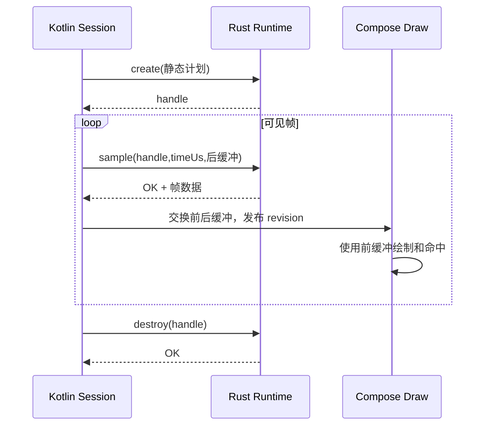

# Rust Native 计算后端设计

2026-11-16用户批准提前实验Rust以调查性能。已新增development-only
native/experimental-mask：真实Windows x64 DLL/JNI、与Kotlin逐像素及错误边界对照。
它只实验已有CPU遮罩热点，不是本文计划的完整计算session/发布ABI；库和示例尚未接入，
默认Kotlin独立使用。实测同算法复用Kotlin优于该Rust JNI版本，不能宣称native已启用或
全帧改善。结果与继续点见performance.md；下文“尚未引入Rust工程”是初始设计历史。

日期：2026-11-14。版本：设计草案 0.1。状态：可选路线，尚未引入 Rust 工程或二进制。本文细化 [DESIGN.md](DESIGN.md) 的计算后端；不新增 SPW 实现，也不改变原有 Apache-2.0 项目。

## 1. 目的与启用条件

Rust 的首个候选任务是批量采样大量可见文字单元的位姿、正文参数和辉光参数。它接收已经标准化、分词、测量并生成的数值动画计划，不负责解析 `lyrics-core`、Unicode 分界、字体塑形、纹理或 Compose 状态。

P3 的顺序为：Kotlin 完整基线 → 分析热点 → 优化算法和分配 → 单热点 Rust 原型 → 端到端比较 → 决定是否纳入发布。没有测量收益时保留 Kotlin 版本。

GPU 过载、离屏合成、字体 raster 或纹理上传问题优先在图形路径解决。若未来需要 Rust 自行 GPU 绘制，要另写图形后端方案；本文的纯数值 ABI 不宣称支持 GPU 表面共享。

## 2. 模块和依赖

```text
library (Kotlin / Compose)
  ComputeBackend / ComputeSession
  KotlinComputeBackend                 # 总是可用
  spi/NativeBackendFactory             # 供可选适配产物使用

native-runtime-android                 # 按需启用的 Android AAR
native-runtime-desktop                 # JVM 适配与平台 native JAR
  FoliaNative.install()
  JNI facade / library loader
  RustComputeBackend

native/ (Cargo workspace)
  crates/folia-compute/                 # 纯计算；无 JNI 或 Compose 依赖
  crates/folia-ffi/                     # C ABI、校验、句柄、panic 边界
  crates/folia-jni/                     # JVM JNI 入口与 direct buffer 检查
```

`folia-jni` 导出 JNI 函数并依赖 C ABI 包装层／计算内核，打包为动态库；`folia-ffi` 同时可产出供未来 Kotlin/Native 使用的 C ABI 库。避免在 Gradle 中把多个静态内核重复链接进同一个最终库。

以上模块仅在决定实施 native 时创建。默认库产物不依赖 Rust 工具链或 native AAR。可选运行时依赖库本体，库本体通过窄 SPI 接受注册，不反向依赖可选产物。

SPI 版本与 ABI 版本分别校验，不能以 Maven 版本字符串代替二进制布局校验。SPI 标记内部使用，不承诺第三方计算插件 ABI。

## 3. 安装和后端选择

使用方添加平台可选运行时后，启动时显式执行 `FoliaNative.install()`，注册工厂；此时可只探测可用性，延迟到需要创建 session 时加载动态库。

| 配置 | 行为 |
| --- | --- |
| `Auto` | 有已注册且 ABI 兼容的 native 工厂时使用；否则 Kotlin |
| `Kotlin` | 强制 Kotlin，用于兼容、测试和对照 |
| `NativeRequired` | 测试／明确要求场景使用；不可用时报告明确失败，不伪装已启用 |

每次创建 scene 固定一个 backend，避免逐帧来回切换。Auto 模式的可恢复故障可在本帧切回 Kotlin，随后该 scene 禁用 native。后端能力结果缓存到安装／运行时版本，不对每个字或每帧重试加载。

业务 UI API 只暴露偏好和实际状态，不暴露动态库路径或 native 句柄。

## 4. 输入与输出的职责

| 数据 | 生产方 | 传递频率 |
| --- | --- | --- |
| 正文、语言、原始歌词对象 | Kotlin 文档模型 | 不跨 FFI |
| 字体、字形切片、纹理、色板 | Compose owner | 不跨 FFI |
| active / passed / visibility / glow 时间与基础 pose | Kotlin 准备阶段 | 创建／更新 compute scene 时一次批量传入 |
| 采样时间 `timeUs` | Kotlin 帧调度 | 每个可见帧一次 |
| `DrawableFrameV1[]` | Rust sampler | 写入调用方提供的后缓冲 |
| 原始行点击映射 | Kotlin 来源表 | 不跨 FFI |

每个 compute scene 覆盖当前准备窗口内的 drawables；每帧只调用一次批量 sample。首次原型允许对该有限集合完整采样，visibility 标记跳过不可见项。若集合规模导致浪费，再加入版本化的批量索引列表；不要开始就做逐字 native 调用。

新的预取行只需影响准备，不强制重建正在绘制的 session。准备窗口正式切换时创建新 session，首帧成功后提交；旧 session 在不再被当前帧引用时关闭。该重建成本也纳入测量。

## 5. ABI v1 草案

### 5.1 通用约束

- 时间使用 `int64_t` 微秒，范围检查在 Kotlin 边界和 Rust 创建时各做一次。
- 标识和标志使用固定宽度 `uint32_t`；句柄使用 `uint64_t`。
- 几何与输出系数使用 IEEE 754 `float`；内部计算可使用 `double`。
- 不跨边界暴露 `bool`、Rust enum、`Vec`、`String`、slice、异常或 trait object。
- 同进程 JVM direct buffer 使用 native byte order；它不是可跨机器传输的文件格式。
- 数据结构采用自然对齐，显式保留字段并验证大小／offset；不使用 packed 结构。
- 公共符号和结构带版本后缀。不兼容结构改变增加 ABI 主版本。

### 5.2 配置结构

```c
typedef struct FoliaConfigV1 {
    uint32_t abi_version;
    uint32_t struct_size;
    uint32_t unit_plan_stride;
    uint32_t frame_stride;
    uint32_t flags;
    uint32_t algorithm_version;
    float spring_stiffness;
    float spring_damping;
    float spring_mass;
    uint32_t reserved[7];
} FoliaConfigV1; /* 64 bytes */
```

`algorithm_version` 固定词状态、颜色 mix、辉光与 spring 语义；修改算法不能只保持 ABI 相同而让 Kotlin／Rust 行为分叉。保留字段必须为零；未知必需能力返回不支持。

### 5.3 单元计划结构

```c
typedef struct FoliaUnitPlanV1 {
    uint32_t drawable_id;
    uint32_t flags;
    int64_t active_begin_us;
    int64_t active_end_us;
    int64_t visible_begin_us;
    int64_t visible_end_us;
    int64_t glow_begin_us;
    int64_t glow_end_us;
    float waiting_pose[4];   /* x, y, scale, rotationDegrees */
    float active_pose[4];
    float passed_pose[4];
    float pivot[2];
    float bounds[4];         /* left, top, right, bottom */
    uint32_t reveal_mode;
    uint32_t glow_mode;
    uint32_t reserved[6];
} FoliaUnitPlanV1; /* 160 bytes */
```

输入 pose 为文字局部坐标中的位移／scale／转角，尺寸已经由 Compose 测量并解析为物理 px。行级变换与相邻块位置由 Kotlin 合并；不同单元共享同一 shaped run 时，Kotlin 保留其引用关系。

`visible_end_us` 包括允许的 passed／退场上界，不能误用词结束时间。`active_end_us >= active_begin_us`，glow 区间可为零但不能逆序。不可见与瞬时边界由标志和时间语义明确处理。

单位表中的 `drawable_id` 是当前 prepared scene 的稠密索引，不是业务来源行下标。原始歌词引用不跨 FFI。

### 5.4 帧结构

```c
typedef struct FoliaDrawableFrameV1 {
    uint32_t drawable_id;
    uint32_t flags;
    float m00, m01, m10, m11, tx, ty;
    float alpha;
    float color_mix;
    float body_blur;
    float glow_inner_alpha;
    float glow_outer_alpha;
    float clip_begin;
    float clip_end;
    float reserved;
} FoliaDrawableFrameV1; /* 64 bytes */
```

仿射约定：`x' = m00*x + m01*y + tx`，`y' = m10*x + m11*y + ty`。这是二维布局 ABI，不携带三维透视。

`flags` 至少区分 visible／needsDraw；`color_mix` 是基础色到活动色的混合系数，实际色值与 sRGB 混合留在 Kotlin；`body_blur` 是当前物理 px 半径。`clip_begin/end` 是局部归一范围，未启用时为 `0/1`，复杂文字的方向与切片仍由 Kotlin renderer 解释。

数值内核不得把 NaN／Infinity 写成有效帧。opacity／mix／clip 的合法范围为 `0..1`；矩阵参数必须有限，不随意把有意的 spring overshoot 截断成线性插值。

### 5.5 调用接口

```c
typedef uint64_t FoliaHandle;
typedef uint32_t FoliaStatus;

FoliaStatus folia_query_abi_v1(
    void* info, uint64_t info_capacity_bytes);

FoliaStatus folia_create_v1(
    const FoliaConfigV1* config,
    const void* unit_plans,
    uint64_t plan_bytes,
    uint64_t unit_count,
    FoliaHandle* out_handle);

FoliaStatus folia_sample_v1(
    FoliaHandle handle,
    int64_t time_us,
    void* output,
    uint64_t output_capacity_bytes,
    uint64_t* out_required_bytes);

FoliaStatus folia_destroy_v1(FoliaHandle handle);
```

`query_abi` 返回结构大小、关键 offset、算法版本和能力位。实现时定义对应的固定布局 `FoliaAbiInfoV1`；调用者先提供已知的 header 空间，根据返回长度验证，不越界写入未知大小结构。

所有大小单位明确为 bytes。创建时验证 `count * stride` 的 checked multiplication、最大支持数量、结构大小、对齐、时间和数值；scene 复制需要持有的静态数值，不持有 Java buffer 裸地址。

sample 成功时写入当前 scene 的完整帧数组；容量不足时返回所需大小。错误时 output 内容未定义，调用方不得提交该后缓冲，不能假设失败调用没有写过任何字节。

## 6. JVM / JNI 适配

JNI facade 只提供 ABI 查询、create、sample、destroy。JNI 层验证 direct buffer 地址／capacity、显式字节长度、native order 和必要对齐；禁止以 Java `position/limit` 隐式推断 native 地址偏移。

- 静态计划一次性编码到 direct buffer，create 后 Rust 复制静态内容，Kotlin 可复用／释放其引用。
- 输出使用两个固定容量 direct buffer，另保留一个必要的 Kotlin 回退输出；容量随当前准备窗口上界增长，不每帧分配。
- 预建 typed views／索引访问器，不在每个字上创建包装对象或执行 JNI。
- JNI 不保存线程局部 `JNIEnv*` 供其他线程使用；本方案不从 Rust callback 到 Java。
- 必须长期保存 Java 对象时才使用 global reference，并有对应释放；v1 优先不保存此类引用。
- R8／混淆规则保护 JNI 入口或使用明确的动态注册；发布 AAR 包含所需 consumer rules。
- 原型验证 Java 层签名与 Rust ABI 的 long／float 宽度，不依赖平台 `long` 的 C 宽度。

Direct buffer 的内存由 JVM 管理，Rust 不调用 `free`，Kotlin 不调用非公开 Cleaner API。组件释放时关闭 native scene、移除 Kotlin 对 buffer 的强引用；缓冲实际回收时机属于 JVM，需要在内存测试中考虑。

## 7. 所有权、线程与释放

| 资源 | 持有方 | 释放／失效 |
| --- | --- | --- |
| 原始歌词与 prepared source map | Kotlin session | 内容切换／组件释放 |
| native scene 静态数组 | Rust scene | destroy 后无在用引用时释放 |
| native handle | Kotlin ComputeSession | UI owner 调用 close |
| direct buffers | Kotlin runtime | scene／运行时不再持有后交 JVM 回收 |
| 图形纹理／图层 | Compose renderer | 独立于 native scene 生命周期释放 |

每个 compute session 由一个 UI owner 线程串行使用。create、sample、destroy 不并发；close 是 Kotlin 层幂等操作。

句柄采用索引＋generation 的 opaque ID，Rust 使用同步注册表验证，不能把未经校验的任意整数直接解引用成裸指针。查到 scene 后取得受控持有引用再进行计算；destroy 移除注册项，过期 generation 返回 `InvalidHandle`。注册表锁与引用计数开销计入基准。



前缓冲在 draw／命中使用期间不得被复写；v1 的采样与 draw 串行位于同一 owner，禁止把裸 buffer 交给异步 render worker。如果未来引入 worker，则必须增加 lease／第三缓冲／fence 协议，不能继续假设双缓冲天然安全。

Kotlin/Native 后续接入时，C interop 的临时 pinned 地址不能在 pin 作用域之外持有。调用方分配的内存由同一侧释放；Rust 自有分配通过 Rust destroy 释放，不混用 `nativeHeap.free` 和 Rust allocator。

## 8. 错误与异常边界

| 状态 | 含义 | Auto 模式策略 |
| --- | --- | --- |
| `Ok` | 成功 | 提交帧 |
| `InvalidArgument` | 输入长度、数值或范围错误 | 记录版本／计数；用 Kotlin，并禁用当前 native scene |
| `BufferTooSmall` | 输出容量不够 | 安全点扩容后重试一次；本帧可用 Kotlin |
| `InvalidHandle` | 已关闭／过期句柄 | 不重用该句柄；用 Kotlin |
| `UnsupportedAbi` | 大小、算法或能力不兼容 | 关闭 native 路径，缓存能力结果 |
| `WrongThread` | 不符合 owner 约束 | 测试失败；生产用 Kotlin 并上报诊断 |
| `InternalError` | 捕获到的可恢复内部错误 | 丢弃后缓冲，关闭当前 session 的 native 路径 |

FFI 入口不让 Rust panic 跨边界 unwind。选择 unwind 策略的构建在入口使用受控捕获，清理临时资源并返回错误；锁中毒等也返回可诊断状态，不 `unwrap` 到外部。

内存分配失败导致的进程 abort、非法内存访问、JNI 误用等不保证可被此机制恢复。native 与应用在同一进程，不具备崩溃隔离；回退只针对可检测的加载失败和受控返回错误。

## 9. 数值一致性与优化约束

- 所有时间分类、区间判断和端点选取基于整数微秒，Kotlin / Rust 完全一致。
- 随机 seed 的布局结果在 Kotlin 准备阶段生成，native 不重新生成随机布局。
- 两侧共用同一算法版本 fixture 和缓动定义；不得一侧使用 wall clock，另一侧使用媒体时间。
- native 可在内部以 double 求 spring／三角函数，最终转换 float；测试容差与主设计一致。
- 第一个原型不用 fast-math、手写 SIMD、多线程或 GPU，先确认简单批量实现的端到端收益。
- 只有单线程批处理已证实瓶颈后再评估 SIMD；单位数量很小时线程切换不作为默认优化。
- 边界、零时长、极短词、极端有限参数、容量与句柄问题分别测试。

## 10. 构建与产物

| 平台 | 初始目标 | 产物／验证 |
| --- | --- | --- |
| Android 实机 | `arm64-v8a` / Rust `aarch64-linux-android` | AAR 中对应 `.so`；目标设备运行 |
| Android 模拟器 | `x86_64` / Rust `x86_64-linux-android` | ABI 加载、错误路径与基本采样 |
| JVM Desktop | Windows x64 / Rust `x86_64-pc-windows-msvc` | 按平台打包的 native JAR／DLL，验证依赖可加载 |
| 后续 Desktop | Linux / macOS 相应目标 | 有 CI 和实际运行验证后发布 |
| 后续 Kotlin/Native | iOS Arm64 等 | 单独的 cinterop／链接与签名验证，不复用 JNI |

NDK、Rust、JNI 适配依赖、MSVC 运行时策略与目标 API 在原型阶段锁定。Android 同时验证所选 native 工具链／打包方式的 16 KiB 页面兼容性，不仅验证模拟器能加载。

Gradle 的 native 任务明确声明 Cargo 输入、锁文件、目标 triple、输出与 build type；不把本机编译结果误当成所有平台产物。默认 Kotlin-only 构建没有 Rust／NDK 仍应可用。

Android 动态库由标准 JNI 打包／加载机制定位。Desktop 若从 JAR 提取 DLL，使用应用缓存下按版本＋平台＋内容摘要分目录，原子写入；不能覆盖已加载的 Windows DLL，也不把目录切到用户音乐路径。离线使用不从网络下载运行时。

发布映射建议采用 `lyrics-ui-folia-native-android` 和平台明确的 Desktop 可选坐标；最终名称在 P3 固定。库本体不传递依赖所有平台二进制。

## 11. 端到端验证

在同一设备、字体、视口、歌词、质量与刷新率下对比：

1. Kotlin 优化基线。
2. native 原型，包含 JNI、验证、结果读取和提交。
3. native 原型中的纯计算时间，仅用于定位额外开销。

测试场景：普通句、300 单元压力句、多声部、密集 seek、暂停／恢复、反复创建释放、重排与窗口变化。预热后做多轮交替运行，记录温度／调频等环境变化，避免只拿一次最快值。

记录 P50／P95／P99 采样耗时、总帧耗时、准备延迟、分配、native／JVM 内存、GC、包体增加、初始化与 scene 重建成本。检测实际后端，避免测到静默回退后的 Kotlin 路径。

启用依据：行为测试通过；真实热点端到端稳定改善；整体帧耗时或准备延迟有对应收益；内存和维护成本可接受。热点成本降低约 20% 是初始评审参考，不替代整体收益分析，也不是既有测量结论。

附加可靠性验证：ABI 大小／offset 静态断言；随机边界与时间 fixture；错误容量和旧句柄；重复 close；JNI 检查模式；目标可用工具链上的 sanitizer；长时间运行与内存回收。崩溃／失败样本只使用合成内容。

## 12. 实施检查表

- [ ] Kotlin 采样器、代表样本与可重现基线已经存在。
- [ ] 已选出一个可量化热点，而不是因语言偏好迁移全部实现。
- [ ] ABI 结构、大小、offset、算法版本和 byte order 测试通过。
- [ ] 输出双缓冲、scene 所有权、关闭和错误返回路径通过测试。
- [ ] Kotlin／Rust 在端点选择上完全一致，数值在约定误差内。
- [ ] Android / Desktop 对应目标产物可独立加载。
- [ ] Kotlin-only 使用方不需要 native 工具链或二进制。
- [ ] native 来源、Cargo 依赖和发布声明齐全。
- [ ] 基准证明端到端收益后，才将该 native 路径加入正式支持矩阵。

## 13. 官方参考

- [Android JNI tips](https://developer.android.com/ndk/guides/jni-tips)。
- [Android 16 KB 页面大小支持](https://developer.android.com/guide/practices/page-sizes)。
- [Rust FFI](https://doc.rust-lang.org/nomicon/ffi.html)。
- [Kotlin 与 C 互操作](https://kotlinlang.org/docs/native-c-interop.html)。

上述资料用于边界设计；具体版本、工具链选项与打包行为在 native 原型阶段再次核验。
